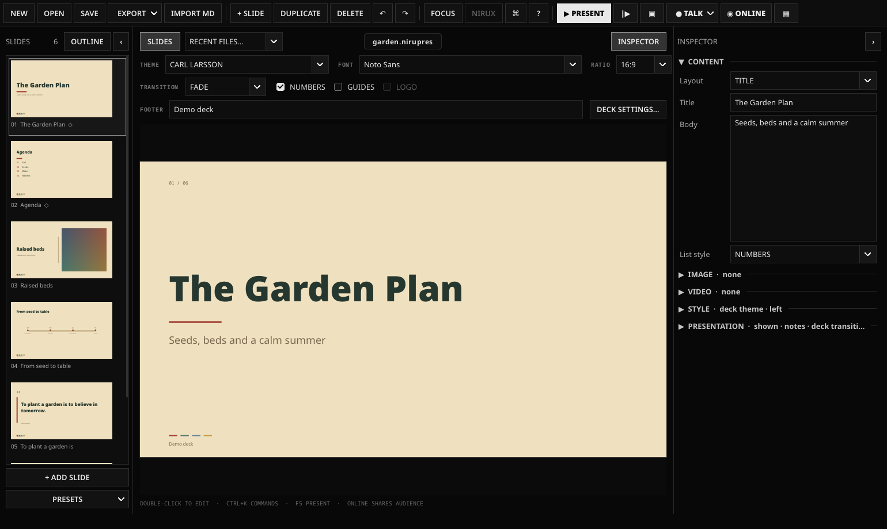

# NIRUPRES

Minimal, keyboard-oriented presentation studio with presenter view, PDF/PPTX export and talk recording.

**Status: beta** · Part of the [NIRUX](https://github.com/nirucon/nirux) suite · [MIT License](LICENSE)



## About

NIRUPRES is the app I make and give presentations with. Decks are built from
a fixed set of strong layouts and themes, so they look consistent without
fiddling, and every deck is a single `.nirupres` file with its images inside.
Since 3.0 it is written in Rust: one static binary that draws its own
windows on X11 (x11rb and its own canvas, no GUI toolkit). It starts in about
20 ms and uses about 20 MB of memory, where the 2.x Python/Qt version needed
about half a second and 100 MB.

It is a NIRU app first and a NIRUX extra second. The editor chrome can follow
the active NIRUX theme, but slide themes never do: a deck must look the same
on every machine, projector and export. It also runs outside NIRUX, for
example on Arch/Omarchy with Wayland.

## Features

- 28 slide layouts (title, statement, bullets, agenda, image, image with
  caption, split, two and three columns, compare, quote, big number, KPI,
  process, timeline, matrix, comparison table, code, video, full bleed and
  more) and 17 slide themes, including Satie, Carl Larsson and the Uddevalla
  family.
- Text always stays inside its box: each text shrinks to fit (in pixels, the
  same on every screen and export), and only if it is still too long it is
  cut with an ellipsis. Lists that are too long show "+N more". Deck health
  renders every slide and names the slide that does not fit, and the slide
  list marks it with a **FIT** badge.
- Opt-in organization profiles for new decks: **Neutral** (default on fresh
  installations) or **Uddevalla** (logo, starters, title preset).
- Speaker notes, a presenter window and an audience window on the screen you
  choose (Display Setup), with spotlight, focus, zoom, curtain, black/white
  screen, pause and jump-to-slide.
- Safe online presenting (Teams, Meet, Zoom), on a laptop alone or docked:
  see [Presenting in Teams, Meet or Zoom](#presenting-in-teams-meet-or-zoom).
- PDF export (also from the command line) and image-based PowerPoint export.
  PowerPoint slides are rasterized; their content is not natively editable.
- Markdown import/export in a documented format
  ([NIRUPRES-MARKDOWN-SPEC.md](NIRUPRES-MARKDOWN-SPEC.md)) and an AI brief you
  can hand to any text model ([NIRUPRES-AI-GUIDE.md](NIRUPRES-AI-GUIDE.md)).
  No AI account or API key is needed.
- **Talk mode:** present from the start while NIRUCLIP records the slides,
  your voice and, if you like, a small camera picture in the bottom-right
  corner. Only the audience picture is recorded, never the presenter view
  with notes, timer and next slide, also on a single laptop screen. Each
  slide change becomes a chapter, and `.chapters.json` and `.srt` files are
  written beside the recording.
- Verified saves (the old file is replaced only after the new one checks out)
  and an autosave recovery file for unsaved decks.
- **Follow NIRUX** editor chrome, on by default when NIRUX is detected.
- Video slides play local files and YouTube or Vimeo links in the audience
  window through mpv (`Space` plays and pauses).

## Requirements

- Linux with X11 (NIRUWM, any X11 window manager, or XWayland). The release
  binary is static and needs no libraries.
- Fonts: Noto Sans and Noto Sans Mono (the slide themes use them); fontconfig
  (`fc-list`) to find them.
- Optional: `mpv` (and `yt-dlp` for web links) for video slides, NIRUCLIP
  0.14 or newer and `ffprobe` for Talk mode (the X server needs the Composite
  extension, which every Xorg has), and NIRUX (`niructl`) for presenting
  mode.

## Installation

### With NIRUX

NIRUPRES is an optional extra, not part of a normal `nirux install`:

```sh
nirux extras install nirupres
nirux extras update            # later: update selected extras to the pinned version
```

NIRUX downloads the pinned release tag, verifies its SHA-256 and runs the
project's own `install.sh`.

### Standalone

From a checkout or the release files:

```sh
./install.sh            # downloads the static binary of this version and checks its SHA-256
./install.sh --build    # or build it here with cargo
nirupres
```

The installer puts `nirupres` in `~/.local/bin`, adds the desktop entry, the
icon and the `application/x-nirupres` MIME type. It replaces a 2.x (Python)
installation cleanly: the old code, launcher and virtual environment are
removed, and your preferences, recent files and autosave in
`~/.local/share/nirupres` stay. Decks are not touched; they open unchanged.

Upgrade notes per version are in [UPGRADE.md](UPGRADE.md).

## Usage

```sh
nirupres [deck.nirupres]                 # the editor (opens the deck)
nirupres --present deck.nirupres         # present from the beginning
nirupres --talk deck.nirupres [PROFILE] [--video-sound]
                                         # present and record; PROFILE: auto (default),
                                         # slides-camera, slides or camera
nirupres --export-pdf deck.nirupres [out.pdf]
nirupres --check-config                  # data root, chrome source, file formats
nirupres --version
nirupres --help
```

Editor keys:

| Key | Action |
|---|---|
| `Ctrl+N` / `Ctrl+O` | New / open |
| `Ctrl+S` / `Ctrl+Shift+S` | Save / save as |
| `Ctrl+Enter` | Add slide |
| `Ctrl+D` / `Ctrl+Shift+D` | Duplicate slide / new slide with the same layout |
| `Ctrl+Shift+C` / `Ctrl+Shift+V` | Copy / paste slides |
| `Alt+Up` / `Alt+Down` | Move the current slide |
| `Ctrl+Z` / `Ctrl+Shift+Z` | Undo / redo |
| `Ctrl+K` | Command palette |
| `Ctrl+Shift+E` | Export deck to PDF |
| `Ctrl+Alt+E` | Export current slide to PNG |
| `F5` / `Shift+F5` | Present from the current slide / from the start |

While presenting:

| Key | Action |
|---|---|
| `Right`, `Down`, `Page Down`, `Space` | Next slide (`Space` plays/pauses a video slide); on the last slide the slides fade to black, and Next again ends |
| `Left`, `Up`, `Page Up` | Previous slide |
| `Home` / `End` | First / last slide |
| digits, then `Enter` | Jump to that slide |
| `B` / `W` | Black / white screen |
| `C` | Curtain |
| `S` / `F` | Spotlight / focus (aim with the mouse over the slides or over CURRENT in the presenter view; click to pin) |
| `[` / `]` | Smaller / larger spotlight or focus |
| `Z` | Zoom in where you aim, and out again |
| `P` | Pause |
| `Esc` | End the presentation: the slides fade to black, then close (press again to close at once) |
| `Ctrl+-` / `Ctrl++` | Smaller / larger speaker notes (also the A− / A+ buttons; remembered) |

Clicking the audience window goes forward on the right half and back on the
left half.

A presentation fades in from black when it starts (in an online presentation
when you press **Start presenting**) and fades out to black when it ends. The
**CURRENT** slide in the presenter view shows the same fades, slide
transitions, spotlight, focus and zoom as the audience, so you see what they
see even when the audience window is behind the presenter view. Point at
CURRENT with the mouse to aim spotlight, focus and zoom; click it to pin the
spotlight. Turn the fades off with *cinematic open/close* or *reduce motion* in
the deck settings.

## Presenting in Teams, Meet or Zoom

NIRUPRES has two windows while you present, and their names say what they are:

| Window title | What it is |
|---|---|
| `AUDIENCE · share this · NIRUPRES` | Only the slides. This is the one you share. |
| `PRIVATE presenter · do not share` | Your presenter view with notes, next slide and timer. It has a red **PRIVATE** bar, so it is easy to spot even in a picker thumbnail. |

**On a laptop alone:** press `F5` (or **Online** in the toolbar). With one
screen NIRUPRES asks whether you want the **Laptop presenter** (the presenter
view fills the screen and covers a 16:9 audience window) or **Slides only**
(for a projector that mirrors your screen). Tick *Remember my choice* to skip
the question; **Presenter View…** asks again.

**Docked with more screens:** **Presenter View…** puts the audience fullscreen
on the screen you choose and the presenter view on the laptop or editor screen.

**Share check:** before an online presentation starts, NIRUPRES tells you
exactly what to pick: in Teams click **Share**, open the **Window** tab and pick
`AUDIENCE · share this · NIRUPRES`. The audience window flashes a green border
and a *SHARED WINDOW* badge for 5 seconds, so you can see in the Teams preview
that the right window is shared, and you are warned if the audience window is
hidden (a hidden shared window freezes). Then press **Start presenting**; the
timer starts there.

While you present:

- The editor is hidden and comes back when you end the presentation.
- You can switch workspaces (for example to Teams) and come back; the audience
  keeps seeing the current slide, and the arrow keys work again at once. On
  NIRUWM the audience window stays mapped on a hidden workspace
  (`_NIRUWM_KEEP_MAPPED`), so a share never freezes. The presenter view warns
  if the audience window is hidden anyway.
- With NIRUX, NIRUPRES turns on presenting mode (`niructl present on --pid`):
  Do Not Disturb is on and NIRUBAR hides private modules. It is turned off when
  you end, and NIRUWM turns it off by itself if NIRUPRES crashes. With an older
  NIRUWM it uses `niructl dnd on` and restores your previous Do Not Disturb
  state, also on the next start after a crash.
- Nothing private is ever drawn in the audience window: no notes, timer or
  next slide.

## Configuration

NIRUPRES has no configuration file to edit; choices are made in the app and
stored as small JSON files in the data root:

- **Follow NIRUX** chrome: toggle **NIRUX** in the toolbar or use the command
  palette. The theme is the one NIRUWM publishes on the root window
  (`_NIRUWM_THEME`, live), with user themes from `~/.config/niruwm/themes` and
  overrides from `~/.config/niruwm/appearance.toml`. Without NIRUX the
  original monochrome Noir chrome is used.
- **Profile:** **New → Profile** or `Ctrl+K` → "Profile". It only affects new
  decks; every deck keeps its own logo setting.
- **Display Setup:** choose the presenter and audience screens. The same
  screen for both means laptop presenter mode.
- **One screen:** the remembered F5 choice (laptop presenter or slides only)
  is stored in `display.json`; **Presenter View…** asks again.
- `NIRUPRES_TALK_DIR`: where Talk mode writes recordings (default `~/Videos`).

Details on chrome, Talk mode, profiles and autosave: [docs/GUIDE.md](docs/GUIDE.md).

## Files and paths

| Path | Purpose |
|---|---|
| `~/.local/bin/nirupres` | The program (one static binary) |
| `~/.cache/nirupres/fonts-v2` | The font list from fontconfig (rebuilt when fonts change) |
| `~/.local/share/nirupres/autosave.json` | Recovery file for an unsaved deck (removed on save, open or normal close) |
| `~/.local/share/nirupres/recent.json`, `display.json`, `file-workflow.json`, `ui.json` | Recent files, display, file-dialog and inspector preferences |
| `~/.local/share/nirupres/profile.json` | Organization profile |
| `~/.local/share/nirupres/presenter.json` | Speaker notes text size |
| `~/.local/share/nirupres/presenting.json` | Only while presenting: the Do Not Disturb state to restore after a crash |
| `~/.local/share/applications/nirupres.desktop`, `~/.local/share/mime/packages/nirupres.xml` | Desktop entry and the `application/x-nirupres` MIME type |
| `~/Videos/NIRUPRES-*.mkv` | Talk recordings, with `.chapters.json` and `.srt` |

`XDG_DATA_HOME` moves the data root; install and run with the same value.

## Troubleshooting

- **Text looks different from 2.x.** Install Noto Sans and Noto Sans Mono;
  NIRUPRES uses the same fonts Qt found through fontconfig.
- **The inspector layout is in a bad state.** Delete
  `~/.local/share/nirupres/ui.json` to restore the default inspector layout.
- **Talk mode does not start.** NIRUCLIP 0.14 or newer must be installed and
  not already recording; NIRUPRES shows NIRUCLIP's error, a busy camera or a
  missing command instead of pretending to record. With an older NIRUCLIP it
  refuses to record rather than fall back to a screen recording that could
  show your notes.
- **The editor does not follow NIRUX.** Run `nirupres --check-config`; it
  prints where the chrome theme came from.
- **Teams shows a frozen slide.** The audience window was hidden (minimised or
  on a hidden workspace with an older window manager). Show it again; the
  presenter view and the Share check warn about this.
- **A slide has a FIT badge.** Its text did not fit and was cut or some items
  were hidden. Open Deck health (`Ctrl+K`) for the details, then shorten the
  text or split the slide.

## Uninstall

```sh
nirux extras uninstall nirupres            # with NIRUX
./uninstall.sh                             # standalone, from a checkout
./uninstall.sh --purge                     # also delete preferences and autosave
```

A normal uninstall removes the launcher, desktop entry, icon, MIME type, the
application code and its virtual environment, and keeps your preferences and
autosave in `~/.local/share/nirupres`. Your `.nirupres` decks are wherever you
saved them and are not affected.

## Building from source

```sh
cargo build --release
cargo test
./target/release/nirupres --self-test-fit       # every layout, four text lengths, three sizes
sh tests/xvfb.sh target/release/nirupres        # end-to-end in a private Xvfb
```

Source layout:

- `src/model.rs`, `src/package.rs`, `src/zip.rs`: project format 9 and the `.nirupres` package
- `src/render.rs`, `src/textfit.rs`, `src/fonts.rs`, `src/images.rs`: the slide renderer
- `src/pdf.rs`, `src/pptx.rs`, `src/export.rs`: PDF, PowerPoint and PNG export
- `src/markdown.rs`: NIRUPRES Markdown and the AI brief
- `src/editor.rs`, `src/dialogs.rs`, `src/ui.rs`: the editor
- `src/present.rs`, `src/presenting.rs`, `src/video.rs`, `src/talk.rs`: presenting, NIRUX presenting mode, video and Talk mode
- `src/x.rs`, `src/canvas.rs`, `src/app.rs`: X11, the canvas and the event loop

Project format 9 and Markdown format 2 are unchanged since 2.0. See
[CHANGELOG.md](CHANGELOG.md), [CONTRIBUTING.md](CONTRIBUTING.md) and
[SECURITY.md](SECURITY.md).

### Performance (3.0.0 against 2.4.0)

Measured on othala in the same private Xvfb (1920x1080), fresh user data:

| | 2.4.0 (Python, Qt) | 3.0.0 (Rust) |
|---|---|---|
| Window shown after start | 325 to 650 ms | 9 to 30 ms |
| First frame drawn | about 330 ms | 15 to 50 ms |
| Memory (RSS) | about 100 MB | about 18 to 20 MB |
| CPU while idle | 0 | 0 |

## Status, disclaimer and how it's made

**Status: beta.** Editing, presenting, PDF export and Talk mode work and are covered by unit tests, a template stress render and an end-to-end test in Xvfb. PowerPoint export is image-based, and dual-screen presenting should be rehearsed on the real projector before a live talk.

NIRUX and every niru* project are made by me, Nicklas Rudolfsson
([@nirucon](https://github.com/nirucon)), for me. They are tailored to my own
needs, preferences and workflows, on my own machines. If they fit yours too,
that's a nice bonus.

- **Free and open source.** Anyone is free to use, study, change and share
  it under the [MIT License](LICENSE).
- **No guarantees.** There is no warranty of any kind. Use it at your own
  risk, read what you install and keep backups of anything that matters.
- **How it's made.** Some of these projects I built from scratch by hand. In
  more recent releases I have used Claude, Anthropic's AI, to do much of the
  heavy lifting under my direction: I decide what to build and how it should
  behave, and I test it on my own machines. It saves me a lot of time, and
  the result is quite OK.
- **Alpha, beta, dev, and maybe forever.** Most things here are alpha, beta
  or dev, and may stay that way. Maybe one day there will be a real stable
  release, but given how fast development moves, and how I am as a person,
  maybe never :)

| Label | Meaning |
|---|---|
| dev | Under active construction; may not build, install or work yet. |
| alpha | Works on my machines, but incomplete or rough; expect breaking changes. |
| beta | In daily use on my machines and mostly complete; rough edges remain. |

## License

MIT License, see [LICENSE](LICENSE). Copyright (c) 2026 Ing Leif Nicklas Rudolfsson.
