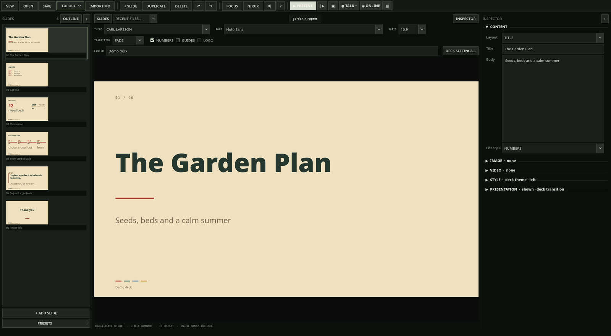

# NIRUPRES

Minimal, keyboard-oriented presentation studio with presenter view, PDF/PPTX export and talk recording.

**Status: beta** · Part of the [NIRUX](https://github.com/nirucon/nirux) suite · [MIT License](LICENSE)



## About

NIRUPRES is the app I make and give presentations with. Decks are built from
a fixed set of strong layouts and themes, so they look consistent without
fiddling, and every deck is a single `.nirupres` file with its images inside.
It is written in Python with PySide6 (Qt 6).

It is a NIRU app first and a NIRUX extra second. The editor chrome can follow
the active NIRUX theme, but slide themes never do: a deck must look the same
on every machine, projector and export. It also runs outside NIRUX, for
example on Arch/Omarchy with Wayland.

## Features

- 25 slide layouts (title, statement, bullets, agenda, image, split, compare,
  quote, big number, KPI, process, timeline, matrix, table, video, full bleed
  and more) and 17 slide themes, including Satie, Carl Larsson and the
  Uddevalla family.
- Opt-in organization profiles for new decks: **Neutral** (default on fresh
  installations) or **Uddevalla** (logo, starters, title preset).
- Speaker notes, a presenter window and an audience window on the screen you
  choose (Display Setup), with spotlight, focus, zoom, curtain, black/white
  screen, pause and jump-to-slide.
- PDF export (also from the command line) and image-based PowerPoint export.
  PowerPoint slides are rasterized; their content is not natively editable.
- Markdown import/export in a documented format
  ([NIRUPRES-MARKDOWN-SPEC.md](NIRUPRES-MARKDOWN-SPEC.md)) and an AI brief you
  can hand to any text model ([NIRUPRES-AI-GUIDE.md](NIRUPRES-AI-GUIDE.md)).
  No AI account or API key is needed.
- **Talk mode:** present from the start while NIRUCLIP records screen,
  camera and/or microphone; each slide change becomes a chapter, and
  `.chapters.json` and `.srt` files are written beside the recording.
- Verified saves (the old file is replaced only after the new one checks out)
  and an autosave recovery file for unsaved decks.
- **Follow NIRUX** editor chrome, on by default when NIRUX is detected.

## Requirements

- Linux with Python 3 and `venv` support (on Debian: `python3-venv`).
- Network access on first install: the installer creates a private virtual
  environment and installs `PySide6` (with Multimedia and WebEngine),
  `python-pptx` and `packaging` from PyPI, as listed in
  [requirements.txt](requirements.txt). No system packages are installed.
- Optional: NIRUCLIP for Talk mode, and NIRUX (`niructl`) for the NIRUX
  editor chrome.

## Installation

### With NIRUX

NIRUPRES is an optional extra, not part of a normal `nirux install`:

```sh
nirux extras install nirupres
nirux extras update            # later: update selected extras to the pinned version
```

NIRUX downloads the pinned release tag, verifies its SHA-256 and runs the
project's own `install.sh`.

### Standalone

Extract the release ZIP (or clone the repository) and run:

```sh
./install.sh
nirupres
```

The installer works in six steps: it creates or reuses the virtual environment
in `~/.local/share/nirupres/.venv`, checks or repairs the dependencies, stages
the release and runs the offscreen release gate on it, takes a rollback
snapshot of the installed code, installs, and verifies the result (release
gate again, launcher from an unrelated directory, `--version`). If any step
fails, the previous code is restored. User data in `~/.local/share/nirupres`
is never part of the release and is preserved.

Upgrade notes per version are in [UPGRADE.md](UPGRADE.md).

## Usage

```sh
nirupres                                 # the editor
nirupres --present deck.nirupres         # present from the beginning
nirupres --talk deck.nirupres [PROFILE]  # present and record; PROFILE: screen-mic (default), screen-camera, camera-mic
nirupres --export-pdf deck.nirupres [out.pdf]
nirupres --check-config                  # data root, chrome source, file formats
nirupres --version
nirupres --help
```

Editor keys:

| Key | Action |
|---|---|
| `Ctrl+N` / `Ctrl+O` | New / open |
| `Ctrl+S` / `Ctrl+Shift+S` | Save / save as |
| `Ctrl+Enter` | Add slide |
| `Ctrl+D` / `Ctrl+Shift+D` | Duplicate slide / new slide with the same layout |
| `Ctrl+Shift+C` / `Ctrl+Shift+V` | Copy / paste slides |
| `Alt+Up` / `Alt+Down` | Move the current slide |
| `Ctrl+Z` / `Ctrl+Shift+Z` | Undo / redo |
| `Ctrl+K` | Command palette |
| `Ctrl+Shift+E` | Export deck to PDF |
| `Ctrl+Alt+E` | Export current slide to PNG |
| `F5` / `Shift+F5` | Present from the current slide / from the start |

While presenting:

| Key | Action |
|---|---|
| `Right`, `Down`, `Page Down`, `Space` | Next slide (`Space` plays/pauses a video slide) |
| `Left`, `Up`, `Page Up` | Previous slide |
| `Home` / `End` | First / last slide |
| digits, then `Enter` | Jump to that slide |
| `B` / `W` | Black / white screen |
| `C` | Curtain |
| `S` / `F` | Spotlight / focus |
| `[` / `]` | Smaller / larger spotlight or focus |
| `Z` | Zoom |
| `P` | Pause |
| `Esc` | End the presentation (press again to skip the fade) |

Clicking the audience window goes forward on the right half and back on the
left half.

## Configuration

NIRUPRES has no configuration file to edit; choices are made in the app and
stored as small JSON files in the data root:

- **Follow NIRUX** chrome: toggle **NIRUX** in the toolbar or use the command
  palette. The theme is read from `niructl theme-catalog --json`, with
  overrides from `~/.config/niruwm/appearance.toml`. Without NIRUX the
  original monochrome Noir chrome is used.
- **Profile:** **New → Profile** or `Ctrl+K` → "Profile". It only affects new
  decks; every deck keeps its own logo setting.
- **Display Setup:** choose the presenter and audience screens.
- `NIRUPRES_TALK_DIR`: where Talk mode writes recordings (default `~/Videos`).

Details on chrome, Talk mode, profiles and autosave: [docs/GUIDE.md](docs/GUIDE.md).

## Files and paths

| Path | Purpose |
|---|---|
| `~/.local/bin/nirupres` | Launcher |
| `~/.local/share/nirupres/nirupres/`, `run.sh`, `.venv/` | Installed code and its virtual environment |
| `~/.local/share/nirupres/autosave.json` | Recovery file for an unsaved deck (removed on save, open or normal close) |
| `~/.local/share/nirupres/recent.json`, `display.json`, `file-workflow.json`, `ui.json` | Recent files, display, file-dialog and inspector preferences |
| `~/.local/share/nirupres/profile.json` | Organization profile |
| `~/.local/share/applications/nirupres.desktop`, `~/.local/share/mime/packages/nirupres.xml` | Desktop entry and the `application/x-nirupres` MIME type |
| `~/Videos/NIRUPRES-*.mkv` | Talk recordings, with `.chapters.json` and `.srt` |

`XDG_DATA_HOME` moves the data root; install and run with the same value.

## Troubleshooting

- **"Python environment is missing. Re-run install.sh."** The virtual
  environment in `~/.local/share/nirupres/.venv` is gone or broken; run
  `./install.sh` again. It does not touch your data.
- **The inspector layout is in a bad state.** Delete
  `~/.local/share/nirupres/ui.json` to restore the default inspector layout.
- **Talk mode does not start.** NIRUCLIP must be installed and not already
  recording; NIRUPRES shows NIRUCLIP's error, a busy camera or a missing
  command instead of pretending to record.
- **The editor does not follow NIRUX.** Run `nirupres --check-config`; it
  prints where the chrome theme came from.

## Uninstall

```sh
nirux extras uninstall nirupres            # with NIRUX
./uninstall.sh                             # standalone, from a checkout
./uninstall.sh --purge                     # also delete preferences and autosave
```

A normal uninstall removes the launcher, desktop entry, icon, MIME type, the
application code and its virtual environment, and keeps your preferences and
autosave in `~/.local/share/nirupres`. Your `.nirupres` decks are wherever you
saved them and are not affected.

## Building from source

There is nothing to compile. The release gate is an offscreen Qt regression
suite with private XDG directories, so it never touches your real data:

```sh
scripts/test.sh            # creates/reuses ./.venv from requirements.txt
scripts/test.sh --system   # use the system python3 and PySide6
```

or by hand:

```sh
python3 -m compileall -q nirupres tests
QT_QPA_PLATFORM=offscreen PYTHONPATH=. python3 tests/release_gate.py
```

Source layout:

- `nirupres/foundation.py`: project model, themes, assets, renderer
- `nirupres/presentation.py`: audience/presenter windows and transitions
- `nirupres/editor.py`: slide editing dialogs and widgets
- `nirupres/markdown_io.py`: Markdown interchange and AI brief
- `nirupres/main.py`: application shell and command line
- `nirupres/ui_toolbar.py`, `ui_inspector.py`, `ui_slides.py`: editor window parts
- `nirupres/profile.py`: organization profiles; `nirupres/talk.py`: Talk mode;
  `nirupres/theme.py`: NIRUX chrome
- `tests/release_gate.py`: the release gate (`tests/gate_22.py` holds the 2.2 checks)

Project format 9 and Markdown format 2 are unchanged since 2.0; decks saved by
2.2 still open in 2.1. See [CHANGELOG.md](CHANGELOG.md),
[CONTRIBUTING.md](CONTRIBUTING.md) and [SECURITY.md](SECURITY.md).

## Status, disclaimer and how it's made

**Status: beta.** Editing, presenting, PDF export and Talk mode work and are covered by an offscreen release gate. PowerPoint export is image-based, and dual-screen presenting should be rehearsed on the real projector before a live talk.

NIRUX and every niru* project are made by me, Nicklas Rudolfsson
([@nirucon](https://github.com/nirucon)), for me. They are tailored to my own
needs, preferences and workflows, on my own machines. If they fit yours too,
that's a nice bonus.

- **Free and open source.** Anyone is free to use, study, change and share
  it under the [MIT License](LICENSE).
- **No guarantees.** There is no warranty of any kind. Use it at your own
  risk, read what you install and keep backups of anything that matters.
- **How it's made.** Some of these projects I built from scratch by hand. In
  more recent releases I have used Claude, Anthropic's AI, to do much of the
  heavy lifting under my direction: I decide what to build and how it should
  behave, and I test it on my own machines. It saves me a lot of time, and
  the result is quite OK.
- **Alpha, beta, dev, and maybe forever.** Most things here are alpha, beta
  or dev, and may stay that way. Maybe one day there will be a real stable
  release, but given how fast development moves, and how I am as a person,
  maybe never :)

| Label | Meaning |
|---|---|
| dev | Under active construction; may not build, install or work yet. |
| alpha | Works on my machines, but incomplete or rough; expect breaking changes. |
| beta | In daily use on my machines and mostly complete; rough edges remain. |

## License

MIT License, see [LICENSE](LICENSE). Copyright (c) 2026 Ing Leif Nicklas Rudolfsson.
